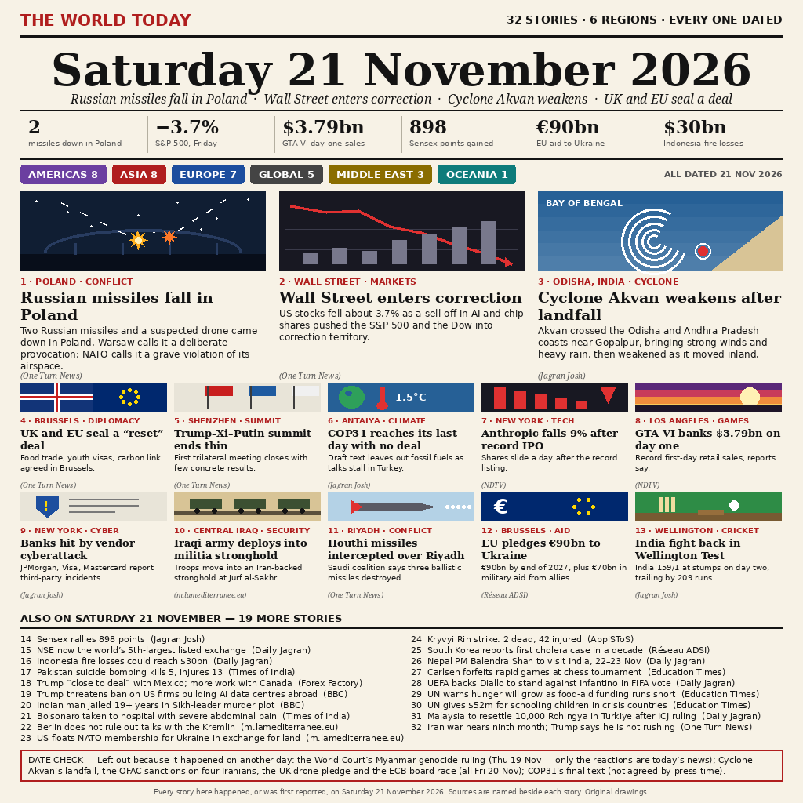

# The World Today — Saturday 21 November 2026

[](https://make.fun/bounty/news-image-20261121)
[](https://make.fun/bounty/news-image-20261121)
[](https://make.fun/bounty/news-image-20261121)

A make.fun entry for
[news-image-20261121](https://make.fun/bounty/news-image-20261121): sum up
Saturday 21 November 2026's world news in one image. The entry is a dense
newspaper front page — **32 stories from 6 regions, every one dated that
day, every one sourced** — drawn by `tools/render.py` and held in this repo
as `entry.png` (1024×1024, 178,174 bytes). `main.ts` copies it to the
grader's output directory after verifying it is a 1024×1024 PNG under 1 MiB.



## How the page is built

A careful picture editor can read this with no news feed: the giant date
headline, a sub-headline naming the four biggest stories, a strip of six
figures that carry the day, colour-coded region tabs, three lead stories
with drawn illustrations, a ten-story grid, a numbered list of 19 more
stories, and a **DATE CHECK** box that names the big stories deliberately
left out because they happened on another day.

## The 32 stories (all happened, or first reported, on 21 Nov 2026)

| # | Story | Region | Source |
|---|-------|--------|--------|
| 1 | Russian missiles fall in Poland | Europe | One Turn News |
| 2 | Wall Street enters correction | Americas | One Turn News |
| 3 | Cyclone Akvan weakens after landfall | Asia | Jagran Josh |
| 4 | UK and EU seal a "reset" deal | Europe | One Turn News |
| 5 | Trump–Xi–Putin summit ends thin | Global | One Turn News |
| 6 | COP31 reaches its last day with no deal | Global | Jagran Josh |
| 7 | Anthropic falls 9% after record IPO | Americas | NDTV |
| 8 | GTA VI banks $3.79bn on day one | Americas | NDTV |
| 9 | Banks hit by vendor cyberattack | Americas | Jagran Josh |
| 10 | Iraqi army deploys into militia stronghold | Middle East | m.lamediterranee.eu |
| 11 | Houthi missiles intercepted over Riyadh | Middle East | One Turn News |
| 12 | EU pledges €90bn to Ukraine | Europe | Réseau ADSI |
| 13 | India fight back in Wellington Test | Oceania | Jagran Josh |
| 14 | Sensex rallies 898 points | Asia | Jagran Josh |
| 15 | NSE now the world's 5th-largest listed exchange | Asia | Daily Jagran |
| 16 | Indonesia fire losses could reach $30bn | Asia | Daily Jagran |
| 17 | Pakistan suicide bombing kills 5, injures 13 | Asia | Times of India |
| 18 | Trump "close to deal" with Mexico; more work with Canada | Americas | Forex Factory |
| 19 | Trump threatens ban on US firms building AI data centres abroad | Americas | BBC |
| 20 | Indian man jailed 19+ years in Sikh-leader murder plot | Americas | BBC |
| 21 | Bolsonaro taken to hospital with severe abdominal pain | Americas | Times of India |
| 22 | Berlin does not rule out talks with the Kremlin | Europe | m.lamediterranee.eu |
| 23 | US floats NATO membership for Ukraine in exchange for land | Europe | m.lamediterranee.eu |
| 24 | Kryvyi Rih strike: 2 dead, 42 injured | Europe | AppiSToS |
| 25 | South Korea reports first cholera case in a decade | Asia | Réseau ADSI |
| 26 | Nepal PM Balendra Shah to visit India, 22–23 Nov | Asia | Daily Jagran |
| 27 | Carlsen forfeits rapid games at chess tournament | Global | Education Times |
| 28 | UEFA backs Diallo to stand against Infantino in FIFA vote | Europe | Daily Jagran |
| 29 | UN warns hunger will grow as food-aid funding runs short | Global | Education Times |
| 30 | UN gives $52m for schooling children in crisis countries | Global | Education Times |
| 31 | Malaysia to resettle 10,000 Rohingya in Turkiye after ICJ ruling | Asia | Daily Jagran |
| 32 | Iran war nears ninth month; Trump says he is not rushing | Middle East | One Turn News |

Date-checked out (in the DATE CHECK box on the page): the World Court's
Myanmar genocide ruling (Thu 19 Nov); Cyclone Akvan's landfall, the OFAC
sanctions on four Iranians, the UK drone pledge and the ECB board race (all
Fri 20 Nov); COP31's final text (not agreed by press time).

## Run it

```sh
mkdir -p out && MAKEFUN_OUTPUT_DIR=out node main.ts   # writes out/entry.png
python3 tools/render.py   # re-draws entry.png from the story table (Pillow)
```

No network, no clock, no randomness: `main.ts` writes the same bytes on
every run, and `tools/render.py` draws the same image on every run.

## License

MIT — see [LICENSE](LICENSE).
